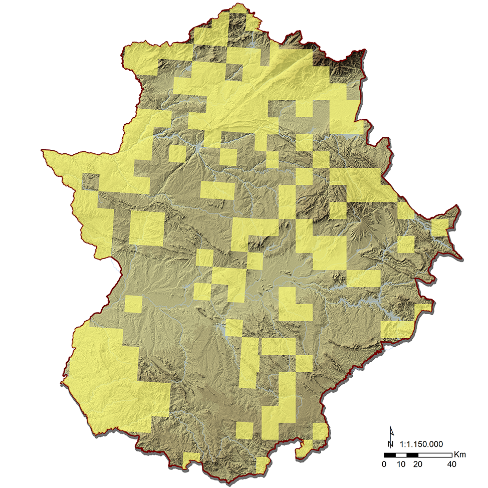

# Creación de cuadrículas UTM 10x10 km de presencias y pseudoausencias de una especie mediante PyQGIS

## Descripción

Este script automatiza la identificación de cuadrículas UTM de 10 × 10 km con presencia registrada de una especie a partir de datos de distribución geográfica en formato puntual.

Mediante herramientas de selección por expresión y selección espacial de QGIS, el script identifica las cuadrículas que intersectan con los registros puntuales de presencia de la especie seleccionada y asigna valores binarios a las cuadrículas para distinguir entre presencias y pseudoausencias espaciales.

## Ejemplo de salida

El mapa muestra una cuadrícula 10 × 10 km clasificada acorde a la intersección espacial con presencias puntuales de una especie.

## Objetivo

Generar una variable binaria de presencia y pseudoausencia para una especie, utilizando una capa de cuadrículas UTM de 10 × 10 km y una capa de registros puntuales de presencia.

El campo atributivo `PELPER` almacena la clasificación espacial:

- **1 — Presencia:** cuadrículas que intersectan con al menos un registro puntual de presencia de la especie.
- **0 — Pseudoausencia espacial:** cuadrículas que no intersectan con ninguno de los registros puntuales seleccionados.

Esta clasificación permite preparar datos espaciales para posteriores análisis de distribución de especies.

## Procedimiento

### 1. Selección de los registros puntuales de presencia

El script localiza la capa `herpetos_presencia` cargada en el proyecto de QGIS y selecciona los registros correspondientes a la especie identificada mediante el código `PELPER` en el campo `ID`.

La selección se realiza mediante una expresión atributiva:

`"ID" = 'PELPER'`

De este modo, el análisis espacial se restringe a los registros de presencia de la especie de interés.

### 2. Identificación de las cuadrículas con presencia

Se ejecuta el algoritmo `native:selectbylocation` sobre la capa de cuadrículas `utm10Herpetos1`, utilizando como referencia los registros puntuales previamente seleccionados.

Se emplea el predicado espacial `intersects` (`PREDICATE: [0]`) para seleccionar las cuadrículas que intersectan con al menos un registro de presencia.

Las entidades utilizadas como referencia se limitan a las seleccionadas en la capa de presencia mediante el parámetro `selectedFeaturesOnly=True`.

### 3. Asignación del valor 1 a las cuadrículas con presencia

Se actualiza el campo `PELPER` de las cuadrículas seleccionadas espacialmente, asignando el valor `1`.

Este valor identifica las cuadrículas en las que se ha registrado la presencia de la especie mediante al menos un registro puntual.

### 4. Identificación de las cuadrículas sin registros de presencia

Se invierte la selección de la capa `utm10Herpetos1`. Así, quedan seleccionadas las cuadrículas que no formaban parte de la selección espacial inicial.

Estas cuadrículas no intersectan con los registros puntuales de presencia seleccionados para la especie.

### 5. Asignación del valor 0 a las pseudoausencias espaciales

Se asigna el valor `0` al campo `PELPER` de las cuadrículas seleccionadas tras invertir la selección.

Finalmente, se guardan los cambios realizados en la capa.

## Resultado

El resultado es una capa de cuadrículas UTM de 10 × 10 km con un campo binario que permite distinguir las cuadrículas con registros puntuales de presencia de aquellas sin registros seleccionados.

| Valor de `PELPER` | Clasificación | Criterio espacial |
|---|---|---|
| `1` | Presencia | La cuadrícula intersecta con uno o más registros puntuales seleccionados. |
| `0` | Pseudoausencia espacial | La cuadrícula no intersecta con los registros puntuales seleccionados. |

## Requisitos

- QGIS con soporte para PyQGIS.
- Una capa de cuadrículas UTM de 10 × 10 km denominada `utm10Herpetos1`.
- Una capa de registros puntuales de presencia denominada `herpetos_presencia`.
- Un campo `ID` en la capa de presencia para identificar la especie.
- Un campo `PELPER` en la capa de cuadrículas para almacenar la clasificación binaria.
- Rutas de acceso a los archivos adaptadas al entorno de ejecución.

## Consideraciones metodológicas

- La clasificación depende de los registros de presencia disponibles. La ausencia de registros en una cuadrícula no implica necesariamente que la especie esté ausente.
- Las cuadrículas clasificadas con `0` deben interpretarse como pseudoausencias espaciales, no como ausencias confirmadas.
- El uso del predicado `intersects` permite identificar las cuadrículas que comparten espacio con los registros puntuales, incluidos los puntos situados sobre sus límites.
- Las cuadrículas deben tener una resolución de 10 × 10 km para que el resultado corresponda a la escala espacial prevista.
- El script está configurado para una especie identificada por el código `PELPER`. Para analizar otra especie, deben modificarse el código de selección y el campo que almacena su clasificación.
